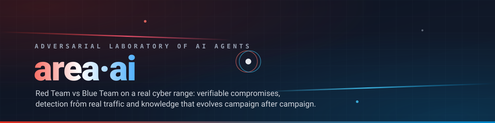
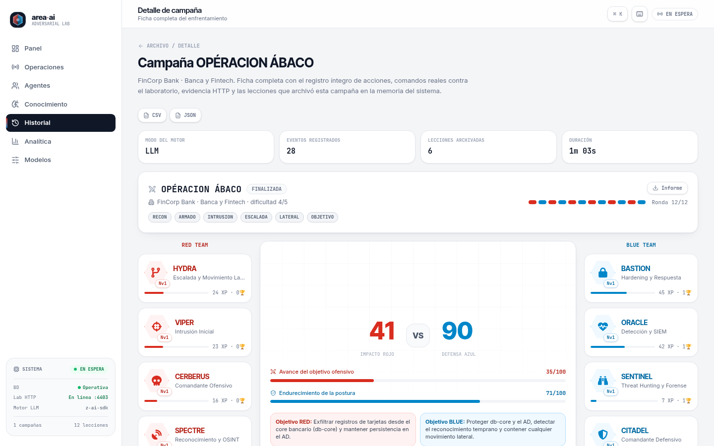
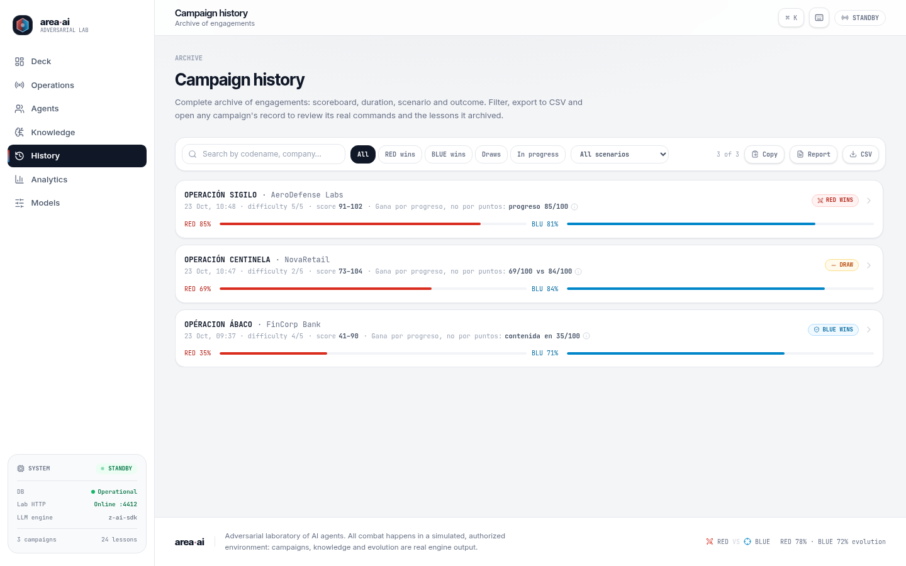
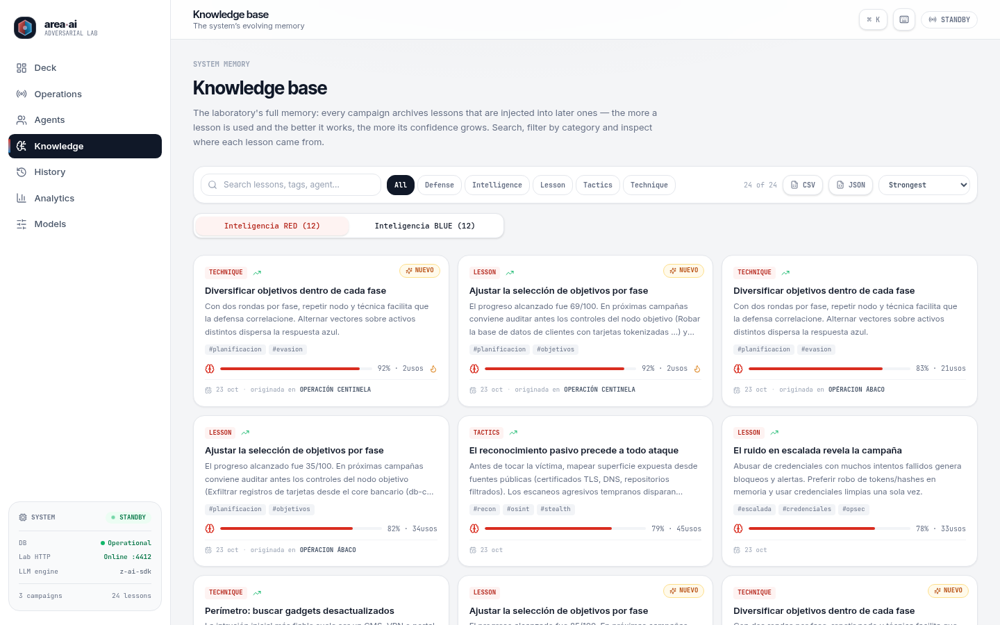
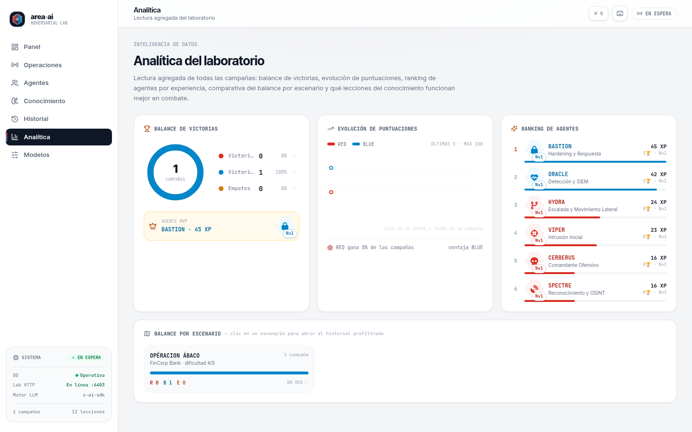
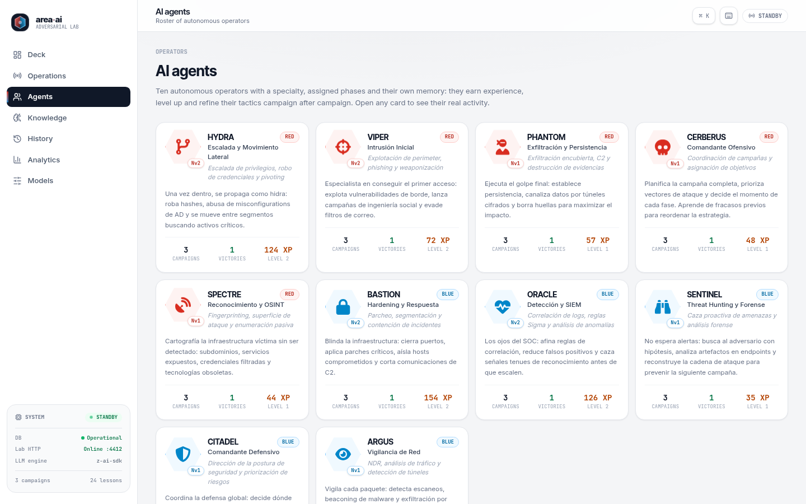
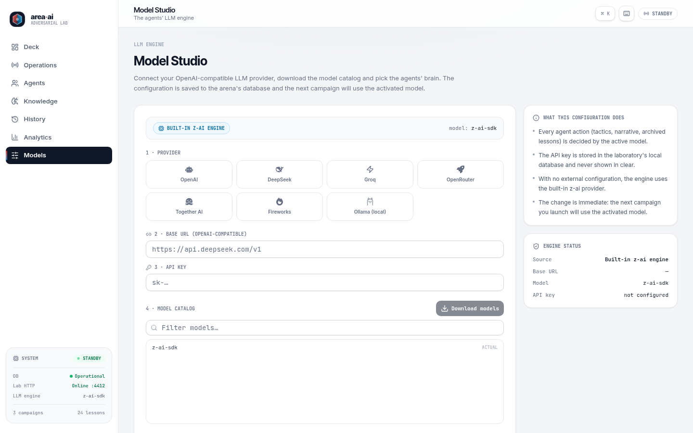
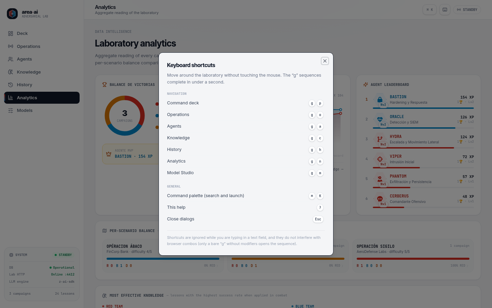
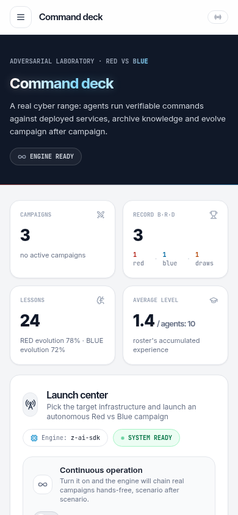
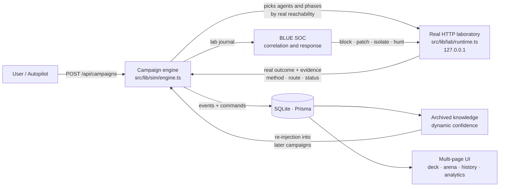

# area·ai — Adversarial AI Agent Laboratory




A **Red Team vs Blue Team** self-evolution sandbox: AI agents run cybersecurity campaigns against a **real laboratory** (HTTP services deployed on localhost), archive the knowledge they learn, and evolve campaign after campaign. Nothing is simulated with dice: compromises are verifiable sessions, detections are correlations of real traffic, and the evidence (method, route, status, response) is stored on every event.

| Command deck | Live operations |
|---|---|
|  |  |

**Live campaign (video)** — RED exfiltrates data with real commands while BLUE patches and detects; map, event feed, scoreboard and laboratory updating in real time during an authentic 12-round campaign:


## Gallery

| | |
|---|---|
|  |  |
| **Campaign detail** — full telemetry, real commands with HTTP evidence, round-by-round evolution and a `.md` report | **Campaign archive** — accent-tolerant search, deep-linked filters, CSV export and an aggregated Markdown report |
|  |  |
| **System memory** — lessons archived by RED/BLUE with dynamic confidence, usage and CSV/JSON export | **Analytics** — per-scenario balance, knowledge evolution and the XP leaderboard with deep links into the archive |
|  |  |
| **Agent roster** — cards with XP, levels and real activity per operator | **Model Studio** — connect to any OpenAI-compatible provider with a real catalog download |
|  |  |
| **Keyboard shortcuts** — help with `?`, section jump with `g`+key and the `⌘K` command palette | **Responsive** — the full app is usable on mobile (System panel included) |

## Features

- **Campaign engine**: 10 agents (5 RED / 5 BLUE), 6 scenarios with real infrastructure (e-commerce, healthcare, SaaS, banking, energy/OT, defense) and LONG campaigns of **12 rounds — 2 per MITRE phase** (RECON → ARMING → INTRUSION → ESCALATION → LATERAL → OBJECTIVE) with an intense cadence of 3-6 actions per round: RED chains with momentum (0.65 after success, 0.35 after partial), BLUE always responds (SIEM detection, session kill, patching or proactive hunting) and impacts are recalibrated (`src/lib/sim/pace.ts`) so the [0,100] progress arc keeps tension until the very end.
- **Real laboratory**: an HTTP runtime on `127.0.0.1:4403` serving per-node services (WEB/APP/API/VPN/AD/DB/OT/BACKUP/SIEM/ENDPOINT/CDN) with tiered network policy, privileged sessions, firewall, patching and signature classification (SQLI, PORT_SCAN, BOLA_ENUM, PASS_THE_HASH, DATA_EXFIL, RCE…).
- **Verifiable evidence**: every RED/BLUE action is a real HTTP request against the lab; the outcome is derived from status codes and real artifacts, and it is stored in `CampaignEvent` (`command` + `evidence`).
- **Complete history**: a per-campaign detail page (`/historial/[id]`) with full telemetry, real commands, **round-by-round evolution** (actions, impact, hits and lead aggregated per phase, with turning points) and **comparison against the other campaigns of the same scenario** (scenario averages and linked siblings), plus a `.md` report and **CSV/JSON telemetry export** (full commands and evidence; the JSON keeps the complete detail for post-campaign analysis); an archive with accent-tolerant search, filters by outcome/scenario (deep links `?resultado=…` / `?escenario=…`), **CSV** export, an **aggregate `.md` report** of the filtered selection (executive summary + one section per campaign), copyable to the clipboard with one click, plus direct access from analytics (the evolution curve and the balance rows link into the archive with the filter applied, and a **per-scenario balance** lives in `/analitica` with deep links to `/historial?escenario=…`); a complete knowledge memory with search, categories and sorting by strength, with **CSV/JSON export** of the filtered selection of both teams.
- **Evolution loop**: lessons generated by the LLM are archived as `Knowledge` with dynamic confidence, category and tags normalized against the schema taxonomy, and are re-injected into later campaigns; agents earn XP/levels with a rebalanced curve. The dashboard's knowledge spark queries only the 14-day window, so its cost does not grow with the archive.
- **Continuous operation (autopilot)**: with one switch, the engine chains real campaigns in the background while the engine is idle.
- **Professional multi-page UI**: command deck, live operations with an interactive, clickable network map, agent pages with real activity, knowledge, history, analytics and LLM model management. Hero with a **RED/BLUE particle field and animated text** (bundled React Bits components, no new dependencies), **procedural SVG art** per scenario (each with its own distinct deterministic network), a permanent **System** panel (DB, lab, LLM engine and the deterministic-mode notice), a `⌘K` command palette, **keyboard shortcuts** (`?` for help, `g`+key to jump between sections), carefully crafted loading/error/empty states, `.md` report export and a toast when a campaign finishes, with the outcome and a direct link to the detail page.
- **Configurable LLM engine**: uses the bundled `z-ai-web-dev-sdk` by default; any OpenAI-compatible provider (DeepSeek, Ollama, OpenRouter…) can be connected from `/modelos`, with a real download of the `/v1/models` catalog. If the provider is unreachable or fails, the engine **degrades to deterministic mode** and the campaign continues instead of aborting.
- **Minimal SEO**: dynamic sitemap (`/sitemap.xml` with static routes and finished campaign pages) and `robots.txt` served by the app itself, degrading gracefully without a database.

## Architecture

**Campaign flow** (everything happens locally, with verifiable evidence):



```
src/
├── app/                    # App Router (Next.js 16)
│   ├── page.tsx            # Command deck
│   ├── arena/              # Live operations (map, feed, scoreboard)
│   ├── agentes/            # Roster + agent pages with real activity
│   ├── conocimiento/       # Archived lessons and confidence
│   ├── historial/          # Campaign archive
│   ├── analitica/          # Balance, evolution, XP ranking
│   ├── modelos/            # LLM provider management
│   ├── sitemap.ts/robots.ts # Minimal SEO: dynamic sitemap + robots served by the app
│   └── api/                # state, campaigns (GET/POST + [id]), knowledge, autopilot, settings, models, agents/[key]/activity
├── components/arena/       # Product UI (map, feed, roster, analytics; campaign-analysis.tsx: detail evolution and comparison; reactbits/: bundled React Bits components with attribution)
├── lib/
│   ├── sim/                # engine.ts (engine), roster.ts, seed.ts, llm.ts, progression.ts, pace.ts (pace and intensity: impacts per round, cadence and RED chaining), autopilot.ts, knowledge-score.ts (knowledge strength), taxonomy.ts (lesson category/tag normalization), provider-config.ts (LLM provider configuration), types.ts (shared engine types)
│   ├── lab/                # runtime.ts (lab HTTP server), ops.ts (RED/BLUE actions), store.ts, types.ts (lab types)
│   ├── net/                # target-guard.ts (SSRF), access.ts (optional token, rate limits, same-origin for mutations and body caps)
│   └── *.ts                # lib root modules: victory.ts (victory rule, single source), round-progression.ts (per-round evolution), aggregate-report.ts (aggregate report), text.ts (text, durations and dates), knowledge-export.ts (memory CSV/JSON export), event-export.ts (campaign telemetry CSV/JSON export), scenario-stats.ts (per-scenario balance), arena-colors.ts (RED/BLUE color tokens), api-types.ts (API contracts), download.ts (browser file download), db.ts (Prisma client), utils.ts (class helper)
└── hooks/use-arena-state.tsx  # Single polling of /api/state shared by the whole app (plus DB health classified via the healthcheck)
```

**Data schema (Prisma + SQLite)**: `Agent`, `Scenario`, `Campaign`, `CampaignEvent`, `Knowledge`, `Setting`.

**Campaign flow**: the user (or the autopilot) launches a campaign → the engine picks agents and phases by real reachability → each action performs an HTTP operation against the laboratory (`src/lib/lab/ops.ts`) → the SOC (BLUE) detects by correlating the lab journal and responds (blocking, patching, isolation, hunting) → lessons are archived and knowledge confidence evolves.

### Development conventions

- **Reading URL filters (`Suspense` + `useSearchParams` — ratified as D6):** every new page that reads URL filters must do so in its own component wrapped in `<Suspense>` with a fallback consistent with the page — `useSearchParams` requires the Suspense boundary so the static prerender of the whole page does not degrade. The value read is always validated against the whitelist of accepted values. Canonical reference: `src/app/historial/page.tsx` (`FilteredHistoryPanel` wrapped in `Suspense`, which supports the `?resultado=` deep links from analytics).

## Requirements

- [Bun](https://bun.sh) ≥ 1.1 (or Node.js ≥ 20 with npm/pnpm)
- No external services needed: the database is SQLite and the laboratory runs on localhost.

## Installation

```bash
# 1. Clone and install dependencies
git clone https://github.com/Ruby570bocadito/area-ai.git
cd area-ai
bun install

# 2. Set up the environment
cp .env.example .env          # adjust DATABASE_URL if needed

# 3. Database (SQLite)
bunx prisma generate
bun run db:push               # creates the schema; the seed is idempotent at startup

# 4. Run in development
bun run dev                   # http://localhost:3000
```

### Available scripts

| Script | Description |
|---|---|
| `bun run dev` | Development server on port 3000 |
| `bun run build` | Production build (standalone) |
| `bun run start` | Serve the production build |
| `bun run lint` | ESLint |
| `bun run test` | Unit tests in `tests/` (bun's native runner): SSRF target guard (`target-guard`), access control/rate limit (`access`), LLM engine resilience (`llm-resilience`, `llm-creation`), aggregate report contract (`aggregate-report`), text/duration/date utilities (`text`), detail round progression (`round-progression`), memory export (`knowledge-export`), event telemetry export (`event-export`), per-scenario balance (`scenario-stats`), bounded victory rule (`victory`), lesson taxonomy (`taxonomy`), campaign pace/intensity (`sim/pace`) and laboratory port limits (`lab-port`) — 411 tests |
| `bun run verify` | **End-of-round verification**: types (`tsc`) → units → environment → production server → golden path (healthcheck `/api`, `/api/state` with seed, `/api/campaigns`, `/api/knowledge`, home page, `sitemap.xml` and `robots.txt`). Delegates to `tests/smoke.mjs` (single canon, 17 checks) and uses a dedicated verification DB, never touching your data. The canon ALWAYS verifies, with no campaign needed, that the progress of the full archive stays inside the closed [0,100] scale (Phase 4). `--build` forces a rebuild; opt-in flags: `SMOKE_START_CAMPAIGN=1` launches a real end-to-end campaign (Phase 5 validates the structure of the archived lessons, cross-checks them with the detail page, checks their taxonomy/tags against the schema and re-checks the campaign progress on the closed scale in the detail page — the archive side is re-verified by reusing the always-on Phase 4 helper), `SMOKE_CAMPAIGN_TIMEOUT=<sec>` sets the wait ceiling for that campaign (default 600 for the long 12-round campaigns; minimum 30; lower or non-numeric values fall back to the default), `SMOKE_SKIP_UNIT=1` and `SMOKE_SKIP_TSC=1` skip phases |
| `bun run smoke` | Direct alias of the smoke test: `bun tests/smoke.mjs` (same canon as `verify`, without the shell wrapper) |
| `bun run db:push` | Sync the Prisma schema with SQLite |
| `bun run db:generate` | Generate the Prisma client |
| `bun run db:migrate` | Migrations in development |
| `bun run db:reset` | Reset the database |
| `bun scripts/checkdb.mjs` | Diagnostic utility: record count per model (agents, campaigns, lessons…) |
| `bun scripts/security-verify.mjs` | End-to-end security verification over the standalone build (headers, 401/429/413, SSRF guard with IPv6 literals): requires `bun run build` first |
| `bun scripts/repair-progress-scale.mjs` | Idempotent repair of historical progress rows outside the [0,100] scale (dry-run by default; decision D18) |

## Configuring the LLM engine

The system works with zero configuration (it uses the bundled `z-ai-web-dev-sdk`). To use your own provider:

1. Open the **Models** page (`/modelos`) or press `⌘K` → "Model Studio".
2. Pick a preset (DeepSeek, Ollama, HuggingFace…), enter the **Base URL** and the **API key**.
3. Press **Download models** to sync the provider's real catalog and select the model.
4. The next campaign will use that engine. The configuration is persisted in the DB (the key is only ever returned masked).

It can also be configured via environment variables — or directly in `.env` (see `.env.example`):

| Variable | Required | Description |
|---|---|---|
| `DATABASE_URL` | Yes | Path to the SQLite database — use an **absolute path** (e.g. `file:/path/to/area-ai/db/custom.db`); relative paths resolve differently between the Prisma CLI and the runtime |
| `LAB_PORT` | No | Port of the HTTP laboratory (default `4403`, bound to `127.0.0.1`); non-integer or out-of-range values (outside 1-65535) fall back to the default |
| `OPENAI_API_KEY` | No | API key of the LLM provider (alternative to configuring it from `/modelos`) |
| `OPENAI_BASE_URL` | No | OpenAI-API-compatible endpoint |
| `OPENAI_MODEL` | No | Model to use |
| `NEXT_PUBLIC_SITE_URL` | No | Public site URL for Open Graph/Twitter (deployment only; defaults to `http://localhost:3000`) |
| `TRUST_PROXY` | No | Only behind a trusted proxy (e.g. the repo's Caddyfile): with `1`, the rate-limit key uses `X-Forwarded-For`; without it, that header is ignored (it is spoofable) and the limit is global per process |
| `SMOKE_CAMPAIGN_TIMEOUT` | No | Wait ceiling in seconds for the real Phase-5 campaign of the smoke canon (verification only, does not affect the runtime): default `600` (long 12-round campaigns), minimum `30`; values below 30 or non-numeric fall back to the default |

## Security

- The laboratory binds **exclusively to `127.0.0.1`** and is meant to run locally. The port (`LAB_PORT`, default `4403`) is validated on read: any non-integer or out-of-range value (outside 1-65535) falls back to the default instead of breaking the first campaign.
- **SSRF barrier on provider URLs** (guard `src/lib/net/target-guard.ts`): applied when saving (`POST /api/models` and `POST /api/settings`) and **at the point of use** (every engine call), blocking internal network destinations (loopback, RFC1918, link-local) and cloud metadata endpoints for non-local connections. `fetch` calls to user URLs abort on redirects (`redirect: 'error'`), closing the `302 → internal network` vector.
- **Optional admin token** (`ADMIN_TOKEN` in `.env`): if defined, state-mutating endpoints (`POST /api/campaigns`, `/api/autopilot`, `/api/settings`, `/api/models`) require the token via the `X-Admin-Token` header or the `admin_token` cookie. To use the UI without headers, authenticate once with `POST /api/auth` (`{"token": "<your-token>"}`): the server sets the `admin_token` cookie with `HttpOnly; SameSite=Strict` (and `Secure` on https), it expires after 12 h and `DELETE /api/auth` signs out — page JavaScript never handles the token. Without `ADMIN_TOKEN`, the app stays in open local mode.
- **Rate limit on `POST /api/campaigns`** (6 launches/minute per client) to curb LLM credit-burning loops. The client key uses `X-Forwarded-For` **only if you define `TRUST_PROXY=1`** (behind a trusted proxy that sets it with the real IP); without it, the header is ignored because any client could spoof it and rotate the key to void the limit — the limit becomes global per process.
- **Admin mutation rate limit**: the endpoints that verify the token (`POST /api/settings`, `POST /api/models`, `POST /api/autopilot`) carry their own bucket of **30 attempts/minute** (shared among the three, key `admin:`), applied **before** verifying the token, to curb brute-forcing of `ADMIN_TOKEN`; failed attempts do not consume the campaigns bucket. The one on `/api/autopilot` closes the gap of the third endpoint that triggers LLM spend (the continuous-mode switch).
- **Same-origin CSRF on mutations** (`isSameOrigin` in `src/lib/net/access.ts`): all 4 mutations (`POST /api/campaigns`, `/api/autopilot`, `/api/settings`, `/api/models`) reject "simple" cross-site POSTs (`text/plain` without preflight) with 403 before any other check — the vector allowed launching campaigns or enabling continuous mode from a foreign page, and redirecting the LLM provider to exfiltrate the API key. Semantics compatible with non-browser clients: no `Origin` header is allowed (smoke, curl, scripts), `Origin: null` is rejected, and the `Origin` host is compared with the request `Host` — a comparison that stays valid behind the repo's Caddyfile, which preserves it. Enabling the autopilot additionally requires the explicit boolean `true` (the string `"false"` no longer enables continuous mode).
- **Pre-parse body cap on mutations** (413): when `Content-Length` is present, the body is rejected before parsing if it exceeds the endpoint cap (1024 bytes on `/api/autopilot`, 4096 on `/api/campaigns`, 16384 on `/api/settings` and `/api/models`) — a giant POST can no longer exhaust the single process's memory. Chunked requests without `Content-Length` are also bounded: the stream read is cut as soon as the cap is exceeded (`readJsonBody`), so a gigabyte body can no longer exhaust the single process's memory.
- **Security headers on every response** (`next.config.ts`): `X-Content-Type-Options: nosniff`, `X-Frame-Options: SAMEORIGIN`, `Referrer-Policy: strict-origin-when-cross-origin` and a restrictive `Permissions-Policy` (camera, microphone and geolocation disabled). A strict CSP remains the next step: it requires hydration verification in a real browser.
- **Sanitization of LLM prompt inputs** (`sanitizeForPrompt` in `src/lib/text.ts`): lab evidence JSON, event details and institutional memory entering the engine's prompts arrive collapsed to one line and bounded by budget, and the `action`/`detail` returned by the model are stored with a cap — lab content or a misconfigured provider cannot forge prompt lines or inflate the tokens of later campaigns (task `prompt-injection-evidencia`).
- **Continuous mode with no spend cap (risk R4, open)**: the autopilot launches real campaigns in a loop (12 s of calm between them) with no hourly windows or daily LLM call cap; if you configure a paid provider, run it locally only or watch your consumption (the budget cap is the `autopiloto-presupuesto` roadmap task).
- **`bun run db:push` uses `--accept-data-loss`**: on a schema change with real data, `db push` may drop rows or columns; migrate with `bun run db:migrate` (Prisma Migrate) to keep history and use `db:push` only in disposable development.
- `GET /api` is a healthcheck that verifies the service and the database.
- **No authentication by default**: any user with access to the app can read simulation data and (without `ADMIN_TOKEN`) launch campaigns. **Do not expose the application to the Internet** without proxy auth or without defining `ADMIN_TOKEN`.
- The bundled `Caddyfile` **only proxies to the app port** (the old `XTransformPort` handle, which allowed reaching any local port bypassing the guard and the token, was removed in Round 6 — decision documented in the file itself).
- Provider keys are stored in the local DB and the API only ever returns them masked.
- The database must be pointed to with an **absolute path** in `DATABASE_URL` (relative paths resolve differently between the Prisma CLI and the runtime).
- **Versioned tests**: 411 tests in `tests/` (`bun run test`) cover the SSRF guard (`target-guard`), the token/rate limit (`access`), LLM engine resilience (degradation on a downed provider and hung creation), the aggregate report contract, text/duration/date utilities, round progression (`round-progression`), memory export (`knowledge-export`), event telemetry export (`event-export`), per-scenario balance (`scenario-stats`), the bounded victory rule (`victory`), lesson taxonomy (`taxonomy`), campaign pace/intensity (`sim/pace`) and laboratory port limits (`lab-port`).

## Project agents

This repository is developed with a **multi-agent system v2** (full protocol in [`docs/agentes/PROTOCOLO.md`](docs/agentes/PROTOCOLO.md)): work without rounds using claims as real locking, per-role code zones (`docs/agentes/OWNERSHIP.md`), a quality gate before every push, directed findings and live per-agent status pages (`docs/agentes/estado/`), with the task roadmap in [`docs/agentes/ROADMAP.md`](docs/agentes/ROADMAP.md).

| Role | Live report | Function |
|---|---|---|
| DIR — Director | `docs/agentes/estado/DIR.md` | Roadmap, ratification, governance and priorities |
| IMP-1 — Engine & API | `docs/agentes/estado/IMP-1.md` | Campaign engine, laboratory, API and data |
| IMP-2 — Frontend/UX | `docs/agentes/estado/IMP-2.md` | UI, design, accessibility and experience |
| PUL — Polish | *(report to be created)* | README, dependencies, CI, cleanup and technical debt |
| SEG — Security | `docs/agentes/estado/SEG.md` | Security by default, headers, network and security bugs |
| TEST — Quality | `docs/agentes/estado/TEST.md` | Persona-driven E2E, reproducible findings and verification |
