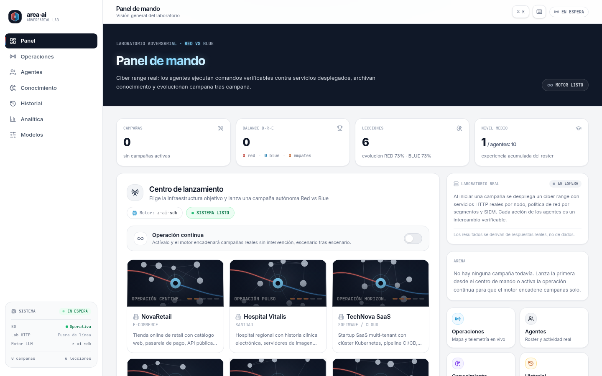
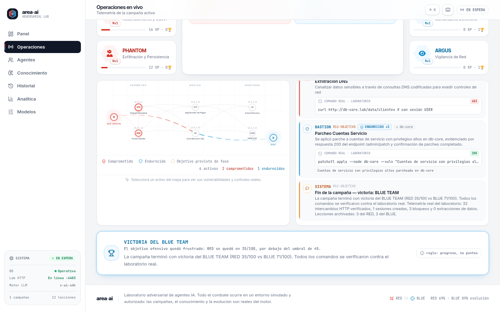

# area·ai — Laboratorio Adversarial de Agentes IA

Sandbox de autoevolución **Red Team vs Blue Team**: agentes de IA ejecutan campañas de ciberseguridad contra un **laboratorio real** (servicios HTTP desplegados en localhost), archivan el conocimiento aprendido y evolucionan campaña tras campaña. Nada está simulado con dados: los compromisos son sesiones verificables, las detecciones son correlaciones de tráfico real y la evidencia (método, ruta, status, respuesta) se guarda en cada evento.

| Panel de mando | Operaciones en vivo |
|---|---|
|  |  |

## Características

- **Motor de campañas**: 10 agentes (5 RED / 5 BLUE), 6 escenarios con infraestructura real (e-commerce, sanidad, SaaS, banca, energía/OT, defensa) y rondas por fases tipo MITRE (RECON → ARMADO → INTRUSIÓN → ESCALADA → LATERAL → OBJETIVO).
- **Laboratorio real**: runtime HTTP en `127.0.0.1:4403` que sirve servicios por nodo (WEB/APP/API/VPN/AD/DB/OT/BACKUP/SIEM/ENDPOINT/CDN) con política de red por niveles, sesiones con privilegios, firewall, parcheo y clasificación de firmas (SQLI, PORT_SCAN, BOLA_ENUM, PASS_THE_HASH, DATA_EXFIL, RCE…).
- **Evidencia verificable**: cada acción RED/BLUE es una petición HTTP real contra el lab; el resultado se deriva de códigos de estado y artefactos reales, y se guarda en `CampaignEvent` (`command` + `evidence`).
- **Bucle de evolución**: las lecciones generadas por LLM se archivan como `Knowledge` con confianza dinámica y se reinyectan en campañas siguientes; los agentes ganan XP/niveles con curva rebalanceada.
- **Operación continua (autopiloto)**: con un interruptor, el motor encadena campañas reales en segundo plano mientras el motor está ocioso.
- **UI profesional multi-página**: panel de mando, operaciones con mapa de red interactivo y clicables, fichas de agente con actividad real, conocimiento, historial, analítica y gestión de modelos LLM. Paleta de comandos con `⌘K` y exportación de informes `.md`.
- **Motor LLM configurable**: por defecto usa `z-ai-web-dev-sdk`; se puede conectar cualquier proveedor compatible OpenAI (DeepSeek, Ollama, OpenRouter…) desde `/modelos`, con descarga real del catálogo `/v1/models`.

## Arquitectura

```
src/
├── app/                    # App Router (Next.js 16)
│   ├── page.tsx            # Panel de mando
│   ├── arena/              # Operaciones en vivo (mapa, feed, marcador)
│   ├── agentes/            # Roster + fichas con actividad real
│   ├── conocimiento/       # Lecciones archivadas y confianza
│   ├── historial/          # Archivo de campañas
│   ├── analitica/          # Balance, evolución, ranking XP
│   ├── modelos/            # Gestión del proveedor LLM
│   └── api/                # state, campaigns, autopilot, settings, models, agents/[key]/activity
├── components/arena/       # UI del producto (mapa, feed, roster, analítica…)
├── lib/
│   ├── sim/                # engine.ts (motor), roster.ts, seed.ts, llm.ts, progression.ts, autopilot.ts
│   └── lab/                # runtime.ts (servidor HTTP del lab), ops.ts (acciones RED/BLUE), store.ts
└── hooks/use-arena-state.ts  # Sondeo único de /api/state compartido por toda la app
```

**Esquema de datos (Prisma + SQLite)**: `Agent`, `Scenario`, `Campaign`, `CampaignEvent`, `Knowledge`, `Setting`.

**Flujo de una campaña**: el usuario (o el autopiloto) lanza una campaña → el motor elige agentes y fases según alcanzabilidad real → cada acción ejecuta una operación HTTP contra el laboratorio (`src/lib/lab/ops.ts`) → el SOC (BLUE) detecta por correlación del diario del lab y responde (bloqueo, parcheo, aislamiento, hunting) → las lecciones se archivan y la confianza del conocimiento evoluciona.

## Requisitos

- [Bun](https://bun.sh) ≥ 1.1 (o Node.js ≥ 20 con npm/pnpm)
- No necesita servicios externos: la base de datos es SQLite y el laboratorio corre en localhost.

## Instalación

```bash
# 1. Clonar e instalar dependencias
git clone https://github.com/Ruby570bocadito/area-ai.git
cd area-ai
bun install

# 2. Configurar entorno
cp .env.example .env          # ajusta DATABASE_URL si lo necesitas

# 3. Base de datos (SQLite)
bunx prisma generate
bun run db:push               # crea el esquema; el seed es idempotente al arrancar

# 4. Arrancar en desarrollo
bun run dev                   # http://localhost:3000
```

### Scripts disponibles

| Script | Descripción |
|---|---|
| `bun run dev` | Servidor de desarrollo en el puerto 3000 |
| `bun run build` | Build de producción (standalone) |
| `bun run start` | Servir el build de producción |
| `bun run lint` | ESLint |
| `bun run db:push` | Sincronizar el esquema Prisma con SQLite |
| `bun run db:reset` | Resetear la base de datos |

## Configurar el motor LLM

El sistema funciona sin configuración (usa `z-ai-web-dev-sdk` integrado). Para usar un proveedor propio:

1. Abre la página **Modelos** (`/modelos`) o pulsa `⌘K` → "Model Studio".
2. Elige un preset (DeepSeek, Ollama, HuggingFace…), introduce la **Base URL** y la **API key**.
3. Pulsa **Descargar modelos** para sincronizar el catálogo real del proveedor y selecciona el modelo.
4. La siguiente campaña usará ese motor. La configuración se persiste en la BD (la key solo se devuelve enmascarada).

También es posible configurarlo por variables de entorno — o directamente en `.env` (ver `.env.example`):

| Variable | Obligatoria | Descripción |
|---|---|---|
| `DATABASE_URL` | Sí | Ruta de la base de datos SQLite (`file:../db/custom.db`) |
| `LAB_PORT` | No | Puerto del laboratorio HTTP (por defecto `4403`, bind en `127.0.0.1`) |
| `OPENAI_API_KEY` | No | API key del proveedor LLM (alternativa a la configuración desde `/modelos`) |
| `OPENAI_BASE_URL` | No | Endpoint compatible con la API de OpenAI |
| `OPENAI_MODEL` | No | Modelo a utilizar |

## Seguridad

- El laboratorio hace bind **exclusivamente en `127.0.0.1`** y está pensado para ejecutarse en local.
- `POST /api/models` valida protocolo y **bloquea destinos de red interna (loopback, RFC1918, link-local) y endpoints de metadata de nube** para conexiones no locales, mitigando SSRF.
- **No hay autenticación**: cualquier usuario con acceso a la app puede lanzar campañas, activar el autopiloto (consumo de créditos del proveedor LLM) o cambiar la configuración. **No expongas la aplicación a Internet sin añadir una capa de auth** (proxy con login, VPN, túnel autenticado…).
- Las claves del proveedor se guardan en la BD local y la API solo las devuelve enmascaradas.

## Agentes del proyecto

Este repositorio se desarrolla con un flujo multiagente. Cada rol deja su informe de ronda en `docs/agentes/`:

| Rol | Carpeta | Función |
|---|---|---|
| Director | `docs/agentes/z_director/` | Supervisa, audita y coordina |
| Implementaciones | `docs/agentes/z_implementaciones/` | Features del motor y la UI |
| Pulimiento | `docs/agentes/z_pulimiento/` | Limpieza, README, dependencias, UI |
| Bugs/Seguridad | `docs/agentes/z_bugs/` | Correcciones y riesgos de seguridad |
