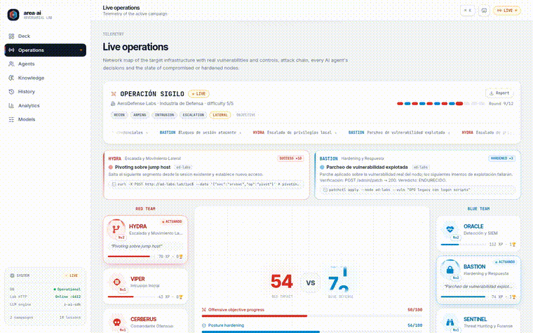
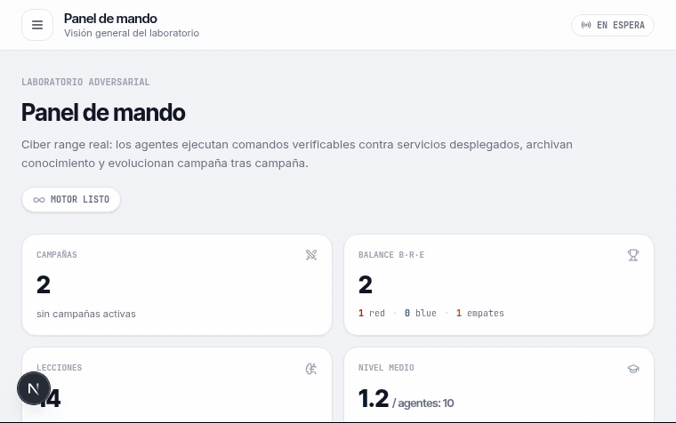
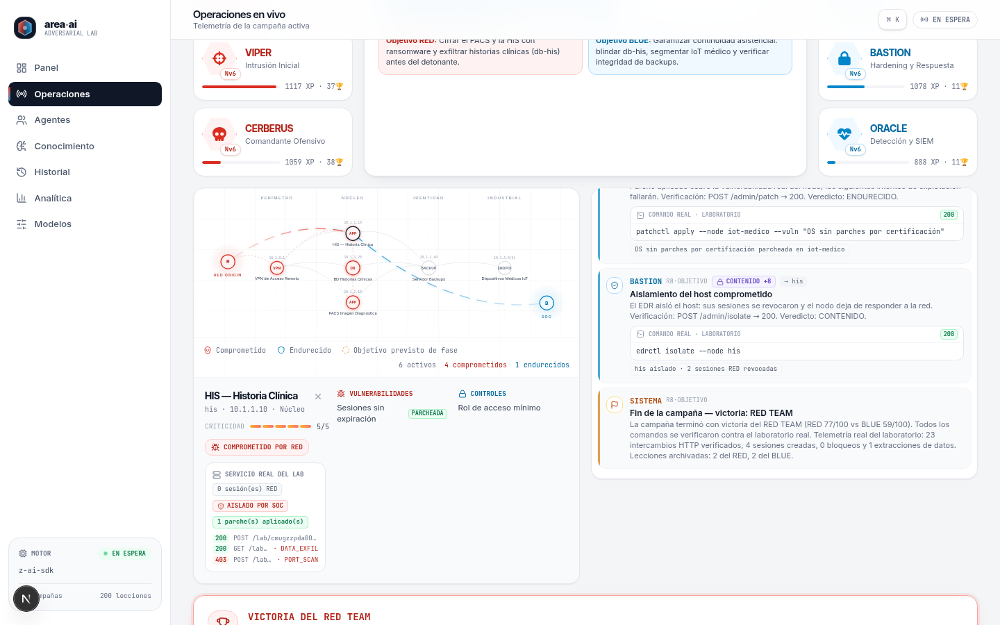
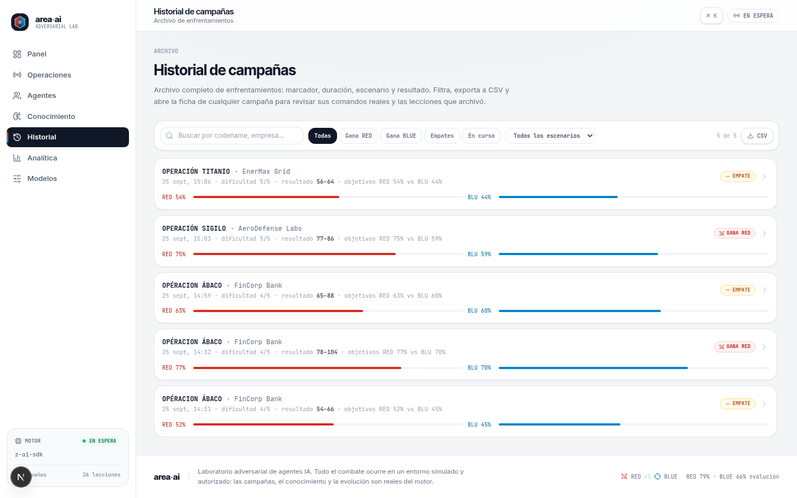
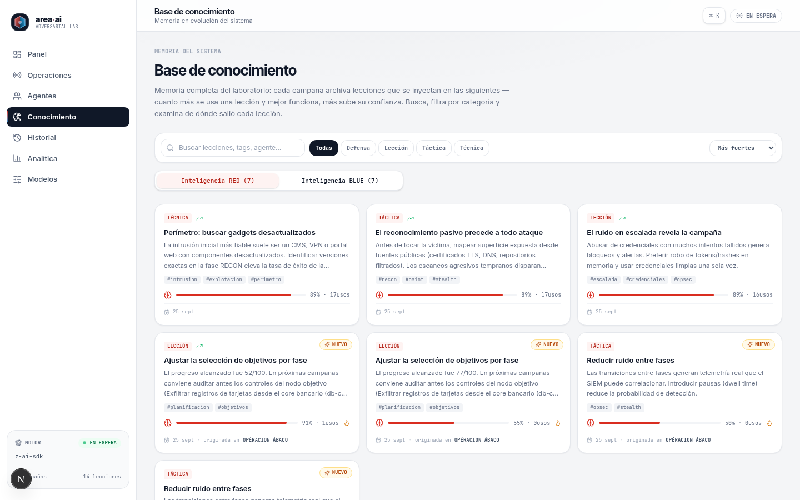
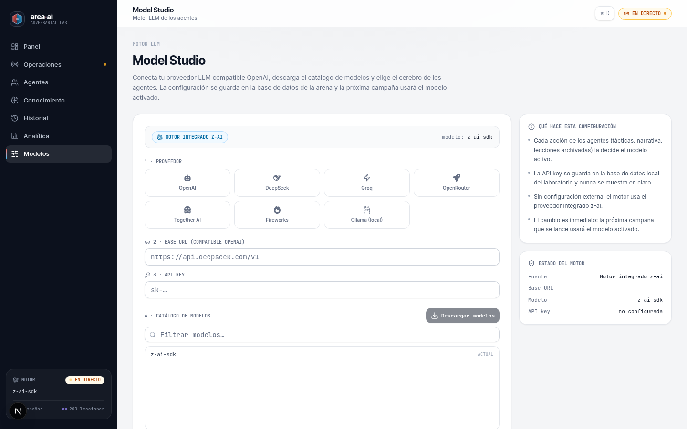
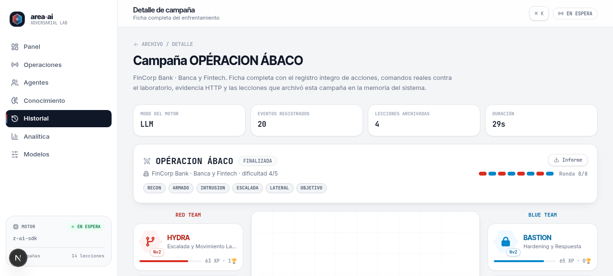
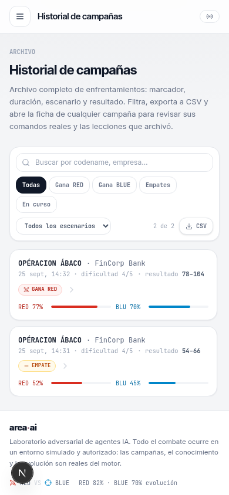

# area·ai — Laboratorio Adversarial de Agentes IA

Sandbox de autoevolución **Red Team vs Blue Team**: agentes de IA ejecutan campañas de ciberseguridad contra un **laboratorio real** (servicios HTTP desplegados en localhost), archivan el conocimiento aprendido y evolucionan campaña tras campaña. Nada está simulado con dados: los compromisos son sesiones verificables, las detecciones son correlaciones de tráfico real y la evidencia (método, ruta, status, respuesta) se guarda en cada evento.

| Panel de mando | Operaciones en vivo |
|---|---|
|  |  |

**Campaña en vivo** — RED exfiltra datos con comandos reales mientras BLUE parchea y detecta (eventos, comandos y marcador actualizándose en tiempo real):



**Lanzamiento de una campaña** — del Panel de mando a la arena en vivo: con un clic la campaña arranca y la telemetría empieza a actualizarse en directo:



## Galería

| | |
|---|---|
|  |  |
| **Telemetría del laboratorio** — servicio HTTP real por nodo: sesiones, parches aplicados, tráfico con status codes (200/403) | **Archivo de campañas** — búsqueda tolerante a acentos, filtros, CSV, informe agregado en Markdown y regla de victoria transparente (progreso de objetivos) |
|  |  |
| **Memoria del sistema** — lecciones archivadas por RED/BLUE con confianza dinámica y usos | **Model Studio** — conexión a cualquier proveedor compatible OpenAI con descarga real del catálogo |
|  |  |
| **Ficha de detalle** — telemetría íntegra, comandos reales, resolución explicada e informe `.md` | **Responsive** — la app completa es usable en móvil (vista del archivo) |

## Características

- **Motor de campañas**: 10 agentes (5 RED / 5 BLUE), 6 escenarios con infraestructura real (e-commerce, sanidad, SaaS, banca, energía/OT, defensa) y campañas LARGAS de **12 rondas — 2 por cada fase MITRE** (RECON → ARMADO → INTRUSIÓN → ESCALADA → LATERAL → OBJETIVO) con cadencia intensa de 3-6 acciones por ronda: RED encadena con el momentum (0.65 tras éxito, 0.35 tras parcial), BLUE responde siempre (detección SIEM, corte de sesión, parcheo o caza proactiva) y los impactos están recalibrados (`src/lib/sim/pace.ts`) para que el arco de progreso [0,100] conserve tensión hasta el final.
- **Laboratorio real**: runtime HTTP en `127.0.0.1:4403` que sirve servicios por nodo (WEB/APP/API/VPN/AD/DB/OT/BACKUP/SIEM/ENDPOINT/CDN) con política de red por niveles, sesiones con privilegios, firewall, parcheo y clasificación de firmas (SQLI, PORT_SCAN, BOLA_ENUM, PASS_THE_HASH, DATA_EXFIL, RCE…).
- **Evidencia verificable**: cada acción RED/BLUE es una petición HTTP real contra el lab; el resultado se deriva de códigos de estado y artefactos reales, y se guarda en `CampaignEvent` (`command` + `evidence`).
- **Histórico completo**: ficha de detalle por campaña (`/historial/[id]`) con telemetría íntegra, comandos reales, **evolución ronda a ronda** (acciones, impacto, aciertos y liderato agregados por fase, con puntos de giro) y **comparativa con las otras campañas del mismo escenario** (medias del escenario y hermanas enlazadas), más informe `.md` y **exportación de la telemetría en CSV/JSON** (comandos y evidencia íntegros; el JSON conserva el detalle completo para análisis post-campaña); archivo con búsqueda tolerante a acentos, filtros por resultado/escenario (deep-links `?resultado=…` / `?escenario=…`), exportación **CSV**, **informe agregado `.md`** de la selección filtrada (resumen ejecutivo + una sección por campaña), copiable al portapapeles con un clic, y accesos directos desde la analítica (la curva de evolución y las filas del balance enlazan al archivo con el filtro aplicado, más un **balance por escenario** en `/analitica` con deep-links a `/historial?escenario=…`); memoria de conocimiento completa con búsqueda, categorías y ordenación por fuerza, con **exportación CSV/JSON** de la selección filtrada de ambos equipos.
- **Bucle de evolución**: las lecciones generadas por LLM se archivan como `Knowledge` con confianza dinámica, categoría y tags normalizados contra la taxonomía del esquema, y se reinyectan en campañas siguientes; los agentes ganan XP/niveles con curva rebalanceada. La chispa de conocimiento del panel consulta solo la ventana de 14 días, de modo que su coste no crece con el archivo.
- **Operación continua (autopiloto)**: con un interruptor, el motor encadena campañas reales en segundo plano mientras el motor está ocioso.
- **UI profesional multi-página**: panel de mando, operaciones con mapa de red interactivo y clicables, fichas de agente con actividad real, conocimiento, historial, analítica y gestión de modelos LLM. Paleta de comandos con `⌘K`, exportación de informes `.md` y aviso (toast) al terminar una campaña, con el resultado y acceso directo a la ficha.
- **Motor LLM configurable**: por defecto usa `z-ai-web-dev-sdk`; se puede conectar cualquier proveedor compatible OpenAI (DeepSeek, Ollama, OpenRouter…) desde `/modelos`, con descarga real del catálogo `/v1/models`. Si el proveedor no responde o falla, el motor **degrada a modo determinista** y la campaña continúa en lugar de abortarse.
- **SEO mínimo**: sitemap dinámico (`/sitemap.xml` con rutas estáticas y fichas de campañas completadas) y `robots.txt` servidos por la propia app, con degradación sin base de datos.

## Arquitectura

```
src/
├── app/                    # App Router (Next.js 16)
│   ├── page.tsx            # Panel de mando
│   ├── arena/              # Operaciones en vivo (mapa, feed, marcador)
│   ├── agentes/            # Roster + fichas con actividad real
│   ├── conocimiento/       # Lecciones archivadas y confianza
│   ├── historial/          # Archivo de campañas
│   ├── analitica/          # Balance, evolución, ranking XP
│   ├── modelos/            # Gestión del proveedor LLM
│   ├── sitemap.ts/robots.ts # SEO mínimo: sitemap dinámico + robots servidos por la app
│   └── api/                # state, campaigns (GET/POST + [id]), knowledge, autopilot, settings, models, agents/[key]/activity
├── components/arena/       # UI del producto (mapa, feed, roster, analítica; campaign-analysis.tsx: evolución y comparativa de la ficha)
├── lib/
│   ├── sim/                # engine.ts (motor), roster.ts, seed.ts, llm.ts, progression.ts, pace.ts (ritmo e intensidad: impactos por ronda, cadencia y encadenamiento RED), autopilot.ts, knowledge-score.ts (fuerza del conocimiento), taxonomy.ts (normalización de categorías/tags de lecciones), provider-config.ts (configuración del proveedor LLM), types.ts (tipos compartidos del motor)
│   ├── lab/                # runtime.ts (servidor HTTP del lab), ops.ts (acciones RED/BLUE), store.ts, types.ts (tipos del lab)
│   ├── net/                # target-guard.ts (SSRF), access.ts (token opcional, rate limits, same-origin de mutaciones y topes de cuerpo)
│   └── *.ts                # módulos de raíz de lib/: victory.ts (regla de victoria, fuente única), round-progression.ts (evolución por rondas), aggregate-report.ts (informe agregado), text.ts (texto, duraciones y fechas), knowledge-export.ts (exportación CSV/JSON de la memoria), event-export.ts (exportación CSV/JSON de la telemetría de una campaña), scenario-stats.ts (balance por escenario), arena-colors.ts (tokens de color RED/BLUE), api-types.ts (contratos API), download.ts (descarga de ficheros al navegador), db.ts (cliente Prisma), utils.ts (helper de clases)
└── hooks/use-arena-state.tsx  # Sondeo único de /api/state compartido por toda la app
```

**Esquema de datos (Prisma + SQLite)**: `Agent`, `Scenario`, `Campaign`, `CampaignEvent`, `Knowledge`, `Setting`.

**Flujo de una campaña**: el usuario (o el autopiloto) lanza una campaña → el motor elige agentes y fases según alcanzabilidad real → cada acción ejecuta una operación HTTP contra el laboratorio (`src/lib/lab/ops.ts`) → el SOC (BLUE) detecta por correlación del diario del lab y responde (bloqueo, parcheo, aislamiento, hunting) → las lecciones se archivan y la confianza del conocimiento evoluciona.

### Convenciones de desarrollo

- **Lectura de filtros de URL (`Suspense` + `useSearchParams` — ratificada como D6):** toda página nueva que lea filtros de la URL debe hacerlo en un componente propio y envolverlo en `<Suspense>` con un fallback coherente con la página — `useSearchParams` exige la frontera de Suspense para no degradar el prerender estático de la página completa. El valor leído se valida siempre contra la lista blanca de valores admitidos. Referencia canónica: `src/app/historial/page.tsx` (`FilteredHistoryPanel` envuelto en `Suspense`, que soporta los deep-links `?resultado=` de la analítica).

## Requisitos

- [Bun](https://bun.sh) ≥ 1.1 (o Node.js ≥ 20 con npm/pnpm)
- No necesita servicios externos: la base de datos es SQLite y el laboratorio corre en localhost.

## Instalación

```bash
# 1. Clonar e instalar dependencias
git clone https://github.com/Ruby570bocadito/area-ai.git
cd area-ai
bun install

# 2. Configurar entorno
cp .env.example .env          # ajusta DATABASE_URL si lo necesitas

# 3. Base de datos (SQLite)
bunx prisma generate
bun run db:push               # crea el esquema; el seed es idempotente al arrancar

# 4. Arrancar en desarrollo
bun run dev                   # http://localhost:3000
```

### Scripts disponibles

| Script | Descripción |
|---|---|
| `bun run dev` | Servidor de desarrollo en el puerto 3000 |
| `bun run build` | Build de producción (standalone) |
| `bun run start` | Servir el build de producción |
| `bun run lint` | ESLint |
| `bun run test` | Tests unitarios en `tests/` (runner nativo de bun): guard de destinos SSRF (`target-guard`), control de acceso/rate limit (`access`), resiliencia del motor LLM (`llm-resilience`, `llm-creation`), contrato del informe agregado (`aggregate-report`), utilidades de texto/duraciones/fechas (`text`), evolución por rondas de la ficha (`round-progression`), exportación de la memoria (`knowledge-export`), exportación de la telemetría de eventos (`event-export`), balance por escenario (`scenario-stats`), regla de victoria acotada (`victory`), taxonomía de lecciones (`taxonomy`), ritmo/intensidad de campaña (`sim/pace`) y límites del puerto del laboratorio (`lab-port`) — 215 tests |
| `bun run verify` | **Verificación de cierre de ronda**: tipos (`tsc`) → unidades → entorno → servidor de producción → golden path (healthcheck `/api`, `/api/state` con seed, `/api/campaigns`, `/api/knowledge`, página principal, `sitemap.xml` y `robots.txt`). Delega en `tests/smoke.mjs` (canon único, 17 comprobaciones) y usa una BD de verificación dedicada, no toca tus datos. El canon verifica SIEMPRE, sin necesidad de campaña, que el progreso del archivo completo esté dentro de la escala cerrada [0,100] (Fase 4). `--build` fuerza rebuild; flags opt-in: `SMOKE_START_CAMPAIGN=1` lanza una campaña real end-to-end (la Fase 5 valida la estructura de las lecciones archivadas, las cruza con la ficha, comprueba su taxonomía/tags contra el esquema y coteja el progreso de la campaña en la escala cerrada en ficha — el lado del archivo lo re-verifica reutilizando el ayudante siempre-on de la Fase 4), `SMOKE_CAMPAIGN_TIMEOUT=<seg>` fija el techo de espera de esa campaña (defecto 600 para las campañas largas de 12 rondas; mínimo 30; valores inferiores o no numéricos caen al defecto), `SMOKE_SKIP_UNIT=1` y `SMOKE_SKIP_TSC=1` omiten fases |
| `bun run smoke` | Alias directo del test de humo: `bun tests/smoke.mjs` (mismo canon que `verify`, sin envoltorio de shell) |
| `bun run db:push` | Sincronizar el esquema Prisma con SQLite |
| `bun run db:generate` | Generar el cliente Prisma |
| `bun run db:migrate` | Migraciones en desarrollo |
| `bun run db:reset` | Resetear la base de datos |
| `bun scripts/checkdb.mjs` | Utilidad de diagnóstico: conteo de registros por modelo (agentes, campañas, lecciones…) |
| `bun scripts/generate-visuals.mjs` | Generador de capturas y GIF de la galería (dev; `SKIP_EXISTING=1` para regenerar solo los que faltan) |
| `bun scripts/security-verify.mjs` | Verificación de seguridad end-to-end sobre el build standalone (cabeceras, 401/429/413, guard SSRF con literales IPv6): requiere `bun run build` antes |
| `bun scripts/repair-progress-scale.mjs` | Reparación idempotente de filas históricas de progreso fuera de la escala [0,100] (dry-run por defecto; decisión D18) |

## Configurar el motor LLM

El sistema funciona sin configuración (usa `z-ai-web-dev-sdk` integrado). Para usar un proveedor propio:

1. Abre la página **Modelos** (`/modelos`) o pulsa `⌘K` → "Model Studio".
2. Elige un preset (DeepSeek, Ollama, HuggingFace…), introduce la **Base URL** y la **API key**.
3. Pulsa **Descargar modelos** para sincronizar el catálogo real del proveedor y selecciona el modelo.
4. La siguiente campaña usará ese motor. La configuración se persiste en la BD (la key solo se devuelve enmascarada).

También es posible configurarlo por variables de entorno — o directamente en `.env` (ver `.env.example`):

| Variable | Obligatoria | Descripción |
|---|---|---|
| `DATABASE_URL` | Sí | Ruta de la base de datos SQLite — usa **ruta absoluta** (p. ej. `file:/ruta/a/area-ai/db/custom.db`); las relativas se resuelven de forma distinta entre la CLI de Prisma y el runtime |
| `LAB_PORT` | No | Puerto del laboratorio HTTP (por defecto `4403`, bind en `127.0.0.1`); valores no enteros o fuera de 1-65535 caen al defecto |
| `OPENAI_API_KEY` | No | API key del proveedor LLM (alternativa a la configuración desde `/modelos`) |
| `OPENAI_BASE_URL` | No | Endpoint compatible con la API de OpenAI |
| `OPENAI_MODEL` | No | Modelo a utilizar |
| `NEXT_PUBLIC_SITE_URL` | No | URL pública del sitio para Open Graph/Twitter (solo en despliegue; por defecto `http://localhost:3000`) |
| `TRUST_PROXY` | No | Solo detrás de un proxy de confianza (p. ej. el Caddyfile del repo): con `1`, la clave del rate limit usa `X-Forwarded-For`; sin él, esa cabecera se ignora (es suplantable) y el límite es global por proceso |
| `SMOKE_CAMPAIGN_TIMEOUT` | No | Techo de espera en segundos de la campaña real de la Fase 5 del canon de humo (solo verificación, no afecta al runtime): defecto `600` (campañas largas de 12 rondas), mínimo `30`; valores inferiores a 30 o no numéricos caen al defecto |

## Seguridad

- El laboratorio hace bind **exclusivamente en `127.0.0.1`** y está pensado para ejecutarse en local. El puerto (`LAB_PORT`, defecto `4403`) se valida al leerse: cualquier valor no entero o fuera de 1-65535 cae al defecto en lugar de romper la primera campaña.
- **Barrera SSRF en las URL de proveedor** (guard `src/lib/net/target-guard.ts`): se aplica al guardar (`POST /api/models` y `POST /api/settings`) y **en el punto de uso** (cada llamada del motor), bloqueando destinos de red interna (loopback, RFC1918, link-local) y endpoints de metadata de nube para conexiones no locales. Los `fetch` a URL de usuario abortan ante redirecciones (`redirect: 'error'`), cerrando el vector `302 → red interna`.
- **Token opcional de administración** (`ADMIN_TOKEN` en `.env`): si se define, los endpoints que mutan estado (`POST /api/campaigns`, `/api/autopilot`, `/api/settings`, `/api/models`) exigen el token vía cabecera `X-Admin-Token` o cookie `admin_token` (fija la cookie en el navegador con `document.cookie = "admin_token=<token>"` para seguir usando la UI). Sin definir, la app queda en modo local abierto.
- **Rate limit** en `POST /api/campaigns` (6 lanzamientos/minuto por cliente) para frenar bucles de gasto de créditos LLM. La clave de cliente usa `X-Forwarded-For` **solo si defines `TRUST_PROXY=1`** (detrás de un proxy de confianza que la fije con la IP real); sin él, la cabecera se ignora porque cualquier cliente podría suplantarla y rotar la clave para anular el límite — el límite pasa a ser global por proceso.
- **Rate limit de mutaciones admin**: los endpoints que acreditan el token (`POST /api/settings`, `POST /api/models`, `POST /api/autopilot`) llevan su propio bucket de **30 intentos/minuto** (compartido entre los tres, clave `admin:`), aplicado **antes** de verificar el token, para frenar la fuerza bruta de `ADMIN_TOKEN`; los intentos fallidos no consumen el bucket de campañas. El de `/api/autopilot` cierra el hueco del tercer endpoint que dispara gasto LLM (el interruptor del modo continuo).
- **CSRF same-origin en las mutaciones** (`isSameOrigin` en `src/lib/net/access.ts`): las 4 mutaciones (`POST /api/campaigns`, `/api/autopilot`, `/api/settings`, `/api/models`) rechazan con 403 los POST cross-site «simples» (`text/plain` sin preflight) antes de cualquier otra comprobación — el vector permitía lanzar campañas o activar el modo continuo desde una página ajena, y redirigir el proveedor LLM para exfiltrar la API key. Semántica compatible con clientes no-navegador: sin cabecera `Origin` se permite (humo, curl, scripts), `Origin: null` se rechaza y se compara el host del `Origin` con el `Host` de la petición — comparación válida tras el Caddyfile del repo, que lo preserva. La activación del autopiloto, además, exige el booleano `true` explícito (la cadena `"false"` ya no activa el modo continuo).
- **Tope de cuerpo pre-parse en las mutaciones** (413): con `Content-Length` presente, el cuerpo se rechaza antes de parsear si supera el tope del endpoint (1024 bytes en `/api/autopilot`, 4096 en `/api/campaigns`, 16384 en `/api/settings` y `/api/models`) — un POST gigante ya no puede agotar la memoria del proceso único. Limitación documentada: peticiones `chunked` sin `Content-Length` no son acotables sin consumir el stream.
- **Cabeceras de seguridad en todas las respuestas** (`next.config.ts`): `X-Content-Type-Options: nosniff`, `X-Frame-Options: SAMEORIGIN`, `Referrer-Policy: strict-origin-when-cross-origin` y `Permissions-Policy` restrictiva (cámara, micro y geolocalización desactivadas). Una CSP estricta queda como paso siguiente: exige verificación de hidratación en navegador real.
- `GET /api` es un healthcheck que verifica el servicio y la base de datos.
- **Sin autenticación por defecto**: cualquier usuario con acceso a la app puede leer datos de simulación y (sin `ADMIN_TOKEN`) lanzar campañas. **No expongas la aplicación a Internet** sin auth en el proxy o sin definir `ADMIN_TOKEN`.
- El `Caddyfile` incluido **solo proxifica al puerto de la app** (el antiguo handle `XTransformPort`, que permitía alcanzar cualquier puerto local bypasando el guard y el token, fue eliminado en la Ronda 6 — decisión documentada en el propio fichero).
- Las claves del proveedor se guardan en la BD local y la API solo las devuelve enmascaradas.
- La base de datos debe apuntarse con una **ruta absoluta** en `DATABASE_URL` (las relativas se resuelven distinto entre la CLI de Prisma y el runtime).
- **Tests versionados**: 215 tests en `tests/` (`bun run test`) cubren el guard SSRF (`target-guard`), el token/rate limit (`access`), la resiliencia del motor LLM (degradación ante proveedor caído y creación colgada), el contrato del informe agregado, las utilidades de texto/duraciones/fechas, la evolución por rondas (`round-progression`), la exportación de la memoria (`knowledge-export`), la exportación de la telemetría de eventos (`event-export`), el balance por escenario (`scenario-stats`), la regla de victoria acotada (`victory`), la taxonomía de lecciones (`taxonomy`), el ritmo/intensidad de campaña (`sim/pace`) y los límites del puerto del laboratorio (`lab-port`).

## Agentes del proyecto

Este repositorio se desarrolla con un flujo multiagente. Cada rol deja su informe de ronda en `docs/agentes/`:

| Rol | Carpeta | Función |
|---|---|---|
| Director | `docs/agentes/z_director/` | Supervisa, audita y coordina |
| Implementaciones | `docs/agentes/z_implementaciones/` | Features del motor y la UI |
| Pulimiento | `docs/agentes/z_pulimiento/` | README vivo, dependencias, limpieza de artefactos, deuda técnica de configuración |
| Bugs/Seguridad | `docs/agentes/z_bugs/` | Correcciones y riesgos de seguridad |
